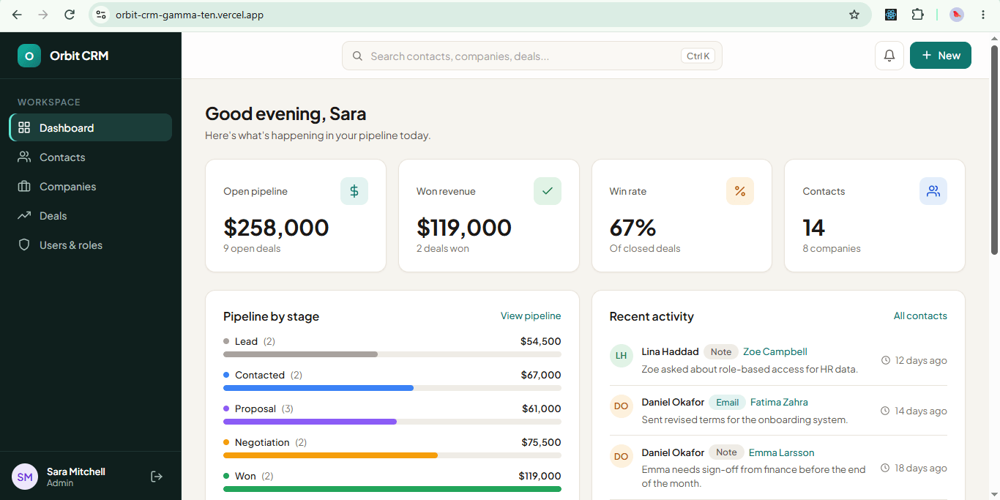
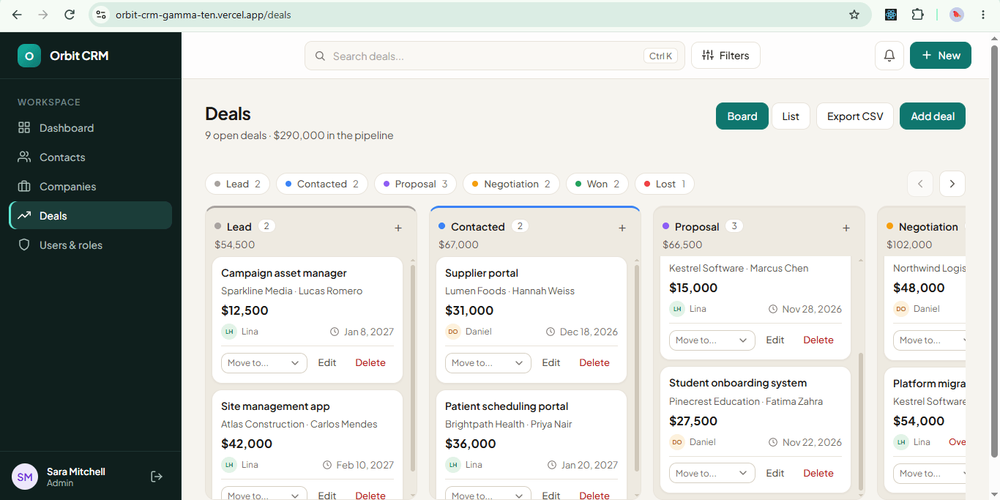
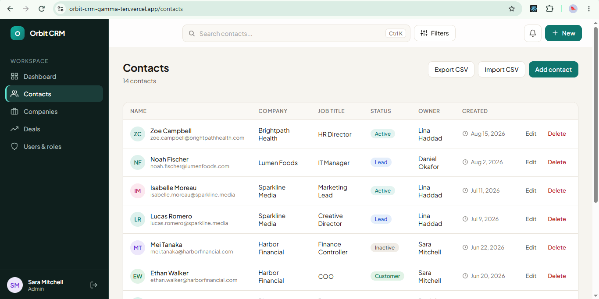
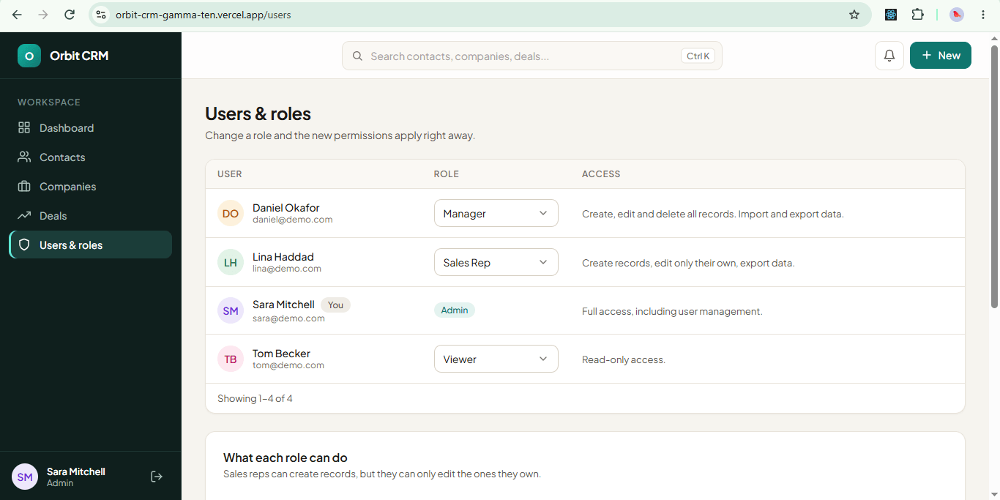
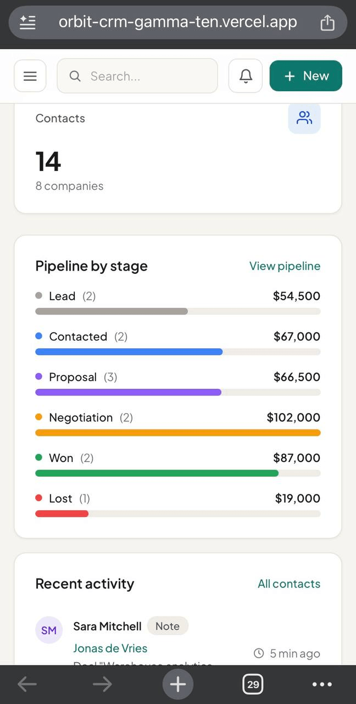

# Orbit CRM

A lightweight CRM for small sales teams. It replaces messy spreadsheets with one clean workspace for contacts, companies and deals, with role-based permissions that are enforced on the server.

**Live demo:** https://orbit-crm-gamma-ten.vercel.app

**Demo video:** https://www.youtube.com/watch?v=QawF8Aodpv4

Use the demo accounts on the login page. Each has a different role, so you can see how permissions change what each person can do. All demo accounts use the password `demo1234`.



## What it does

- **Pipeline board.** Deals on a kanban board with drag and drop, stage shortcuts and edge auto-scroll, plus a sortable list view. Moving a deal writes a line in the contact's activity log.
- **Contacts and companies.** Searchable, sortable tables with detail pages, a full activity history (notes, calls, emails, meetings) and linked deals.
- **One search and one filter panel.** The top-bar search filters whichever list you are on, and works as a finder everywhere else (Ctrl + K). Filters appear as removable chips, and they live in the URL, so a refresh or the Back button keeps them.
- **CSV import and export.** Import contacts from a spreadsheet: duplicates are skipped, missing companies are created, and the whole import runs as one transaction. Export the current filtered view.
- **Roles and permissions.** Admin, Manager, Sales Rep (can only edit their own records) and Viewer (read-only).
- **Notifications.** A bell with an unread count and a notifications page: someone assigns you a record, moves your deal, logs activity on your contact, or changes your role. You are never notified about your own actions.
- **Quick add.** A "+ New" button creates a contact, company or deal from any page.
- **Responsive.** Works on phones, with a slide-in menu and pop-up filters.





## Roles

| Capability | Admin | Manager | Sales Rep | Viewer |
|---|:-:|:-:|:-:|:-:|
| View contacts, companies, deals | ✓ | ✓ | ✓ | ✓ |
| Create records | ✓ | ✓ | ✓ | - |
| Edit records | ✓ | ✓ | Own only | - |
| Delete records | ✓ | ✓ | - | - |
| Log notes and activity | ✓ | ✓ | ✓ | - |
| Import CSV | ✓ | ✓ | - | - |
| Export CSV | ✓ | ✓ | ✓ | - |
| Manage users and roles | ✓ | - | - | - |



## Security

The interface hides what you cannot do, but the **server is what enforces it**. Every request is checked again against the same rules, so calling the API by hand gets the same answers.

- Passwords are hashed with bcrypt, and failed logins are rate limited.
- The login token lives in an `HttpOnly`, `Secure`, `SameSite=Lax` cookie, so page scripts cannot read it.
- Sales reps can only change records they own, and only admins and managers can assign owners.
- Every query is parameterized, and every request body is validated with zod.
- Notifications are scoped to their recipient. Asking for someone else's returns "not found".
- API responses are sent with `Cache-Control: no-store`, so no cache keeps private data.

## Tech stack

| Layer | What |
|---|---|
| Frontend | React, Vite, React Router, styled with plain style objects (no CSS framework) |
| Backend | Node.js, Express 5, zod, bcryptjs, JSON Web Tokens, helmet, express-rate-limit |
| Database | PostgreSQL (Neon in production) |
| Hosting | Vercel (frontend and backend) |

```
Browser ──► Vercel (React app) ──/api──► Vercel (Express API) ──► Neon (PostgreSQL)
```

The frontend forwards `/api` requests to the backend, so the browser sees a single site and the login cookie stays first-party.

<p align="center">
  
</p>

## Run it locally

You need Node.js 20 or newer and a PostgreSQL database.

```bash
git clone https://github.com/gulistankh/orbit-crm.git
cd orbit-crm
```

**Backend**

```bash
cd backend
npm install
cp .env.example .env     # then fill in DATABASE_URL and JWT_SECRET
```

Create the tables by running `backend/src/db/schema.sql` in your database (psql, pgAdmin or the Neon SQL editor), then load the demo data and start the API:

```bash
npm run seed
npm run dev              # http://localhost:5000
```

**Frontend** (in a second terminal)

```bash
cd frontend
npm install
npm run dev              # http://localhost:5173, /api is proxied to the backend
```

## Project structure

```
backend/
  src/
    config/        environment and database connection
    controllers/   one file per resource
    routes/        URLs, permissions and validation
    middleware/    auth, permissions, validation, errors
    db/            schema.sql and the seed script
    utils/         permission rules, SQL helpers, notifications
frontend/
  src/
    components/    ui, layout, contacts, companies, deals, notifications...
    context/       auth and data
    hooks/         data hooks, permissions, page filters
    pages/         one file per screen
    utils/         formatters, CSV, permissions
```

## What I would build next

- Reminders for deals past their expected close date
- An audit log of who changed what
- Server-side pagination for very large teams
- Automated tests for the permission rules

## Author

Built by **Gulistan Kh**, UI/UX designer and full-stack developer working with early-stage B2B SaaS founders.

[LinkedIn](https://www.linkedin.com/in/gulistan-kh/)